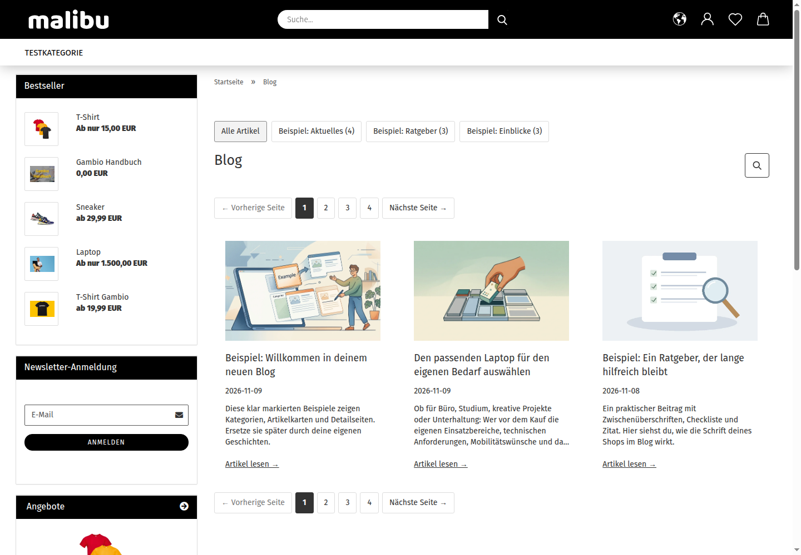
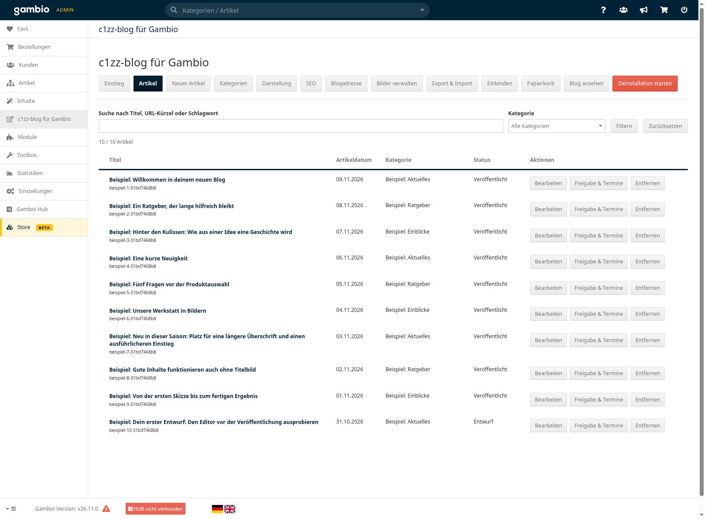
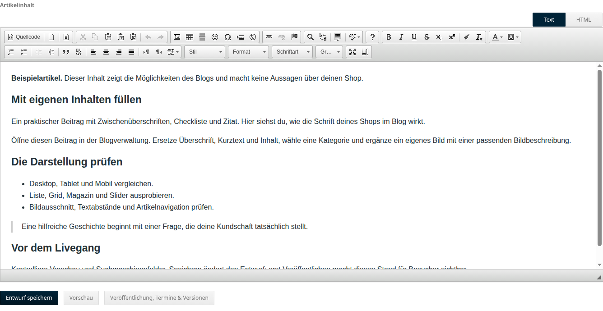
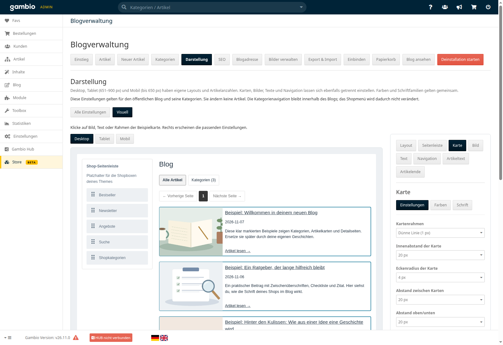
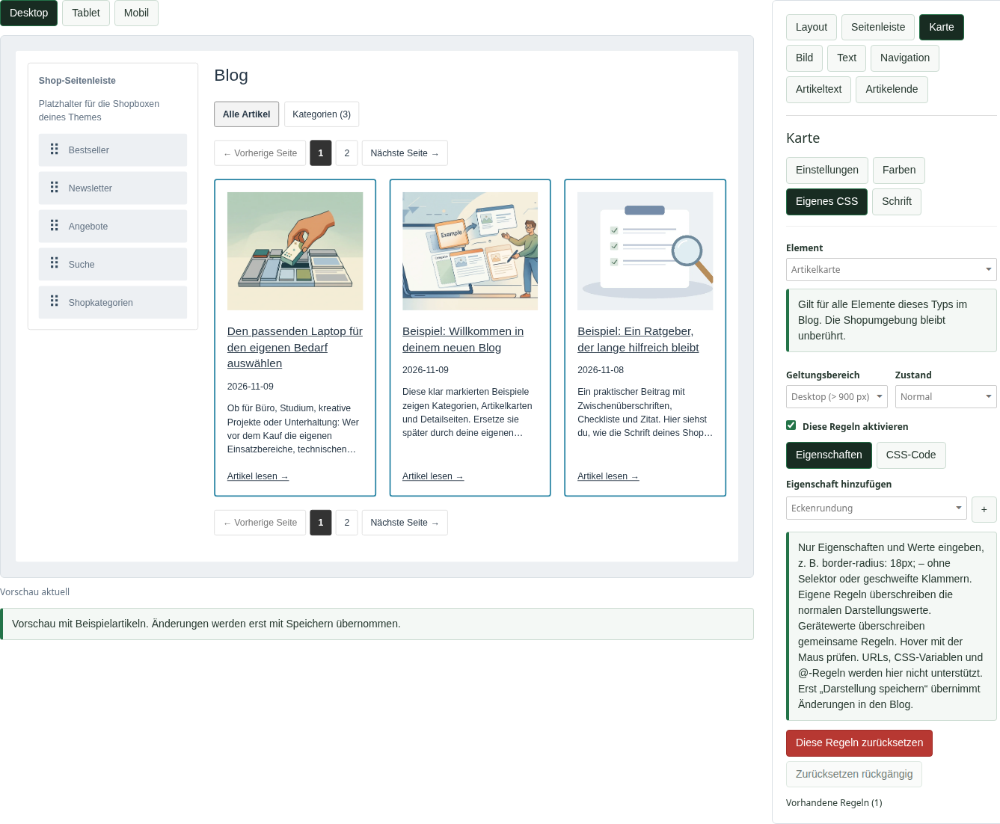

<p align="center"></p>

Aktuell: Deutlicher Versionsstatus unter **Update / Aktualisieren** und vollständige Blog-Navigation mit Deinstallationszugang am Seitenende. Details stehen in den [Release Notes](RELEASE_NOTES.md).

<p align="center"><strong>Release Candidate · 0.47.1-rc.1 · MIT-Lizenz · Entwickelt von Mensch und KI</strong></p>

# Ein Blog, der zu deinem Gambio-Shop passt

Artikel schreiben, Kategorien pflegen und die Darstellung direkt im Shop gestalten: **c1zz-blog für Gambio** ist ein eigenständig installierbares Blogmodul für Gambio. Du brauchst keinen vorbereiteten Blog und keine SSH-Nacharbeiten.

**[Bilderrundgang mit 14 Ansichten](docs/BILDERRUNDGANG.md)** · **[Installer herunterladen](https://github.com/c1zz/gambio-blog/releases/download/v0.47.1-rc.1/c1zz-blog-install-0.47.1.php)** · **[Release & Prüfsummen](https://github.com/c1zz/gambio-blog/releases/tag/v0.47.1-rc.1)** · **[Installation](docs/INSTALLATION.md)** · **[Echtheit prüfen](SECURITY.md)**

> Dies ist ein **Release Candidate**. Bitte zuerst in einem Testshop prüfen und vor dem Einsatz den Shop sichern. Der interne Modulstand und der Dateiname lauten `0.47.1`; `rc.1` kennzeichnet diese Veröffentlichung.

**So sehen Besucher den Blog:** Die Desktopansicht zeigt Artikel, Kategorien und Seitennavigation im Malibu-Shoplayout – einschließlich Shopkopf und Seitenleiste.

[](docs/images/blog-desktop.png)

## Vertrauen vor Installation

Du installierst Software eines zunächst fremden Anbieters in einen Shop, mit dem du Geld verdienen möchtest. **Vertrauen muss deshalb vor der Installation entstehen.** Wir zeigen Herkunft, Änderungen, Datenzugriffe, tatsächliche Prüfergebnisse und bekannte Grenzen. Du entscheidest über Installation und Updates. Prüfsummen und Herkunftsnachweise werden klar von einer unabhängigen Sicherheitsprüfung unterschieden.

## Hilfreiche Inhalte für deine Kunden

Ein Shop kann ohne Blog betrieben werden. Mit einem Blog bekommst du Raum, Produkte und ihren Nutzen verständlich zu erklären: mit Ratgebern, Anwendungsbeispielen, Hintergrundwissen und Antworten auf Kundenfragen. So kannst du hilfreiche Inhalte schaffen, die Kaufentscheidungen unterstützen und zum Verkauf beitragen. Das Modul bietet die Werkzeuge; einen bestimmten Umsatz- oder Rankingeffekt versprechen wir nicht.

## Neu in diesem Release

**Reihenfolge der Artikel:** Unter **Darstellung** wählst du „Artikeldatum: neueste zuerst“ (Standard), „Artikeldatum: älteste zuerst“ oder „Zuletzt veröffentlicht zuerst“. Übersicht, Kategorien, Einbindungen und Vor-/Zurück-Navigation verwenden dieselbe Reihenfolge. Dadurch bestimmt nach einem Import nicht mehr dessen technische Einfügereihenfolge die Anzeige.

**Update / Aktualisieren** lädt neue Versionen nach deiner Bestätigung direkt aus unserem GitHub-Repository. Fortschritt und Fehler bleiben sichtbar; ein unterbrochener Lauf kann fortgesetzt werden. Artikel, Medien und Einstellungen bleiben erhalten. Der gemeinsame c1zz-systems-Stil gilt auch für diese Oberfläche.

**Optional:** [c1zz-ki für Gambio](https://github.com/c1zz/gambio-ki) ergänzt Entwürfe, Themenideen und eine Bildhilfe für die Anbieter-Webseiten direkt beim Artikel. Es hat einen eigenen Installer; der Blog funktioniert auch ohne KI-Modul.

## Was du damit machen kannst

| Inhalte | Darstellung | Betrieb |
|---|---|---|
| Artikel, Entwürfe und Vorschau | Liste, Grid, Slider und Magazin | Geführte Installation und Updates |
| Eigene Kategorien und Schlagwörter | Desktop, Tablet und Mobil getrennt | Versionen und Veröffentlichungstermine |
| Native visuelle Bearbeitung und HTML | Grafischer Editor mit Vorschau | Export und Import mit Bildern |
| Medienverwaltung und Beispielblog | Farben, Schriften, Karten und Navigation | SEO-Felder, Canonical und Sitemap |
| Übersicht und einzelne Artikelseiten | Konfigurierbare Shop-Seitenleiste | Daten behalten oder ausdrücklich löschen |

Du kannst Blogkarten auch über **`[c1zz_blog]`** in unterstützte CMS-Inhalte und Produktbeschreibungen einbinden. Der Bereich **Einbinden** erzeugt den passenden Shortcode mit eigenen Widgetoptionen.

## In Gambio integriert und gezielt deinstallierbar

**Das Modul nutzt Gambio-eigene Funktionen so weit wie möglich und fügt sich in die vorhandene Shopstruktur ein.** Dazu gehören die native Admin-Anmeldung und Zugriffskontrolle, der Formularschutz, der Gambio-Editor, das Modul-Center und die Aufgabenverwaltung. Öffentliche Blogseiten werden über Gambios Shoplayout ausgegeben; Domain und Shop-Unterverzeichnis stammen aus der Shopkonfiguration. Installation und Deinstallation verwenden die nativen Modul- und Cacheabläufe.

Der Modulcode liegt getrennt unter `GXModules/c1zz/c1zzblog/`. **Gambio-Kerndateien und fremde Module werden nicht verändert.** Blogartikel und Metadaten liegen in eigenen Tabellen, Bilder in einem eigenen Medienverzeichnis.

**Der geführte Deinstallationsablauf nimmt den Blog wieder aus dem Betrieb:** Öffentliche Darstellung, Verwaltung und Zeitplanung werden deaktiviert. Standardmäßig bleiben Inhalte und Medien für eine Wiederinstallation erhalten. Ihre vollständige Löschung erfordert eine zusätzliche ausdrückliche Bestätigung. Die Moduldateien bleiben auch dann vorhanden. Selbst gesetzte Bloglinks und eingefügte Shortcodes in Shopinhalten solltest du anschließend entfernen. Einzelheiten stehen unter [Deinstallation](docs/INSTALLATION.md#deinstallation).

## So arbeitest du mit dem Blog

**Artikel im Überblick:** „Neuer Artikel“ steht als grüner Plus-Button links über der Suche. Die obere Navigation bündelt Liste und Editor unter „Artikel“. Suche und Kategoriefilter helfen beim Finden. Die Statusspalte unterscheidet veröffentlichte Artikel und private Entwürfe; Bearbeitung, Freigabe und Termine sind direkt erreichbar.

[](docs/images/artikelverwaltung.png)

**Inhalte schreiben:** Der native Gambio-Editor bietet Formatierung, Bilder und HTML-Ansicht. Darunter liegen **Entwurf speichern**, **Vorschau** und der Zugang zu **Veröffentlichung, Terminen und Versionen**. Der Ausschnitt zeigt den Inhaltsbereich; Titel, Kategorie und SEO stehen weiter oben im Formular.

[](docs/images/editor.png)

**[Zum vollständigen Bilderrundgang →](docs/BILDERRUNDGANG.md)** Dort siehst du auch Einstieg, Kategorien, Artikeldaten und SEO, Freigabe und Termine, die öffentliche Artikelseite und die mobile Ansicht. Alle Bilder lassen sich in Originalgröße öffnen.

## In wenigen Schritten loslegen

1. Den PHP-Installer und `SHA256SUMS` aus demselben [Release](https://github.com/c1zz/gambio-blog/releases/tag/v0.47.1-rc.1) herunterladen und **vor der Ausführung prüfen**.
2. Nur `c1zz-blog-install-0.47.1.php` in den Shopordner neben `shop.php` und `admin/` hochladen. Dateinamen beibehalten.
3. Die Datei im Browser öffnen. Falls nötig, **Admin-Anmeldung öffnen** wählen. Gambio verarbeitet die Anmeldung in seinem eigenen Fenster; danach kehrt der Installer automatisch zurück.
4. Voraussetzungen und Paketprüfung kontrollieren, bei vorhandenen Daten die Sicherung bestätigen und die Einrichtung ausdrücklich starten.
5. Nach erfolgreichem Abschluss entfernt sich die hochgeladene Installationsdatei selbst. In der Blogverwaltung hilft **Einstieg** beim Anpassen an deinen Shop.

Das ZIP ist bereits in der PHP-Datei enthalten. Du musst kein zweites Archiv hochladen. Eine Neuinstallation startet leer; **Beispielartikel, Kategorien und Illustrationen kannst du danach bewusst hinzufügen**.

Spätere Updates starten direkt unter **Update / Aktualisieren**. Die vollständigen Schritte, Voraussetzungen und Hinweise stehen in der [Installationsanleitung](docs/INSTALLATION.md).

## Gestaltung und eigenes CSS am Element

Die grafische Darstellung und **Alle Einstellungen** bearbeiten dieselben Werte. Unter **Eigenes CSS** am ausgewählten Elementtyp bearbeiten visuelle Regler, Farbauswahl und CSS-Code dieselben Regeln. Geräteansicht, Hover und Tastaturfokus lassen sich getrennt gestalten; erst **Darstellung speichern** übernimmt die Änderungen. Du kannst etwa auf Desktop ein Grid und auf Mobil einen Slider verwenden, Bildplatzierung und Textabstände einstellen oder Farben und Schriftgrößen je Gerät anpassen.

**Vorschau und Einstellungen nebeneinander:** Hier ist im grafischen Editor eine **ungespeicherte Grid-Vorschau** geöffnet. Gerätewahl, Spaltenzahl und Artikelzahl sind direkt neben der Vorschau sichtbar. Die öffentliche Desktopaufnahme weiter oben zeigt die gespeicherte Gridansicht.

[](docs/images/darstellung.png)

[](docs/images/element-css.png)

**Blogadressen bleiben steuerbar:** Beim Pfadwechsel entscheidest du, ob die bisherige Adresse weiterleiten soll. Gespeicherte Weiterleitungen kannst du unter **Blogadresse** ändern oder löschen. Hilfetexte sind im gemeinsamen c1zz-systems-Stil hervorgehoben. Entfernen, Löschen und Zurücksetzen eigener Werte sind rot markiert.

Die bisherigen Funktionsansichten wurden am 10.11.2026 mit **Blog 0.46.1 und KI 0.11.1** im lokalen GX26-Testshop mit Malibu erneuert. Sie zeigen Beispiel- und Testinhalte sowie die aktuelle Navigation, Speicherleisten und Updateverwaltung. Der [Bilderrundgang](docs/BILDERRUNDGANG.md) zeigt auch den **mobilen Slider**. Das Aussehen hängt von deinem Theme und deinen Einstellungen ab.

## Was ist tatsächlich geprüft?

Der aktuelle Kandidat wurde mit **Gambio 26.11.0, PHP 8.2.31, MariaDB 10.10 und Malibu** frisch installiert und über die native Modulverwaltung aktualisiert. Dabei wurden auch eine neue Anmeldung während des Updates, wiederholte POST-Aufrufe, Datenerhalt und Wiederherstellung geprüft. Die GitHub-Antworten waren in dieser isolierten Umgebung simuliert; das übernommene Zielpaket entspricht exakt der Auslieferung.

Die genaue Einordnung und offene Prüfungen stehen in [Kompatibilität & Teststand](docs/KOMPATIBILITAET.md). Es gibt keine pauschale Zusage für jedes Gambio-Release, jede PHP-Version oder jedes Theme.

## Herkunft und Sicherheit

- **SHA-256** erkennt Änderungen gegenüber dem veröffentlichten Vergleichswert.
- Der öffentliche Release-Workflow erstellt einen **kryptografischen Herkunftsnachweis** für die vollständige Installerdatei. Er lässt sich mit der GitHub CLI prüfen. Die Shop-Updatefunktion prüft bislang HTTPS und Prüfsummen; sie behauptet keine lokale Signaturprüfung.
- Das mitgelieferte Python-Werkzeug prüft und entpackt das eingebettete Paket **ohne PHP auszuführen**. So lässt sich auch der enthaltene Modulcode ansehen.
- Die Veröffentlichung enthält keine lokale Git-Historie, Shopsoftware, Datenbanksicherungen, Zugangsdaten oder Kundenbestände.

```bash
sha256sum --check SHA256SUMS
```

Was diese Prüfungen aussagen – und was sie nicht nachweisen – erläutert [SECURITY.md](SECURITY.md).

## Von Mensch und KI entwickelt

**Dieses Modul ist gemeinsam durch c1zz und KI-Unterstützung entstanden.** Anforderungen, Produktentscheidungen, Rückmeldungen und praktische Shoptests kamen von c1zz; KI unterstützte bei Implementierung, Fehlersuche, Tests und Dokumentation. Die Entwicklung war ein iterativer Prozess zwischen Mensch und KI.

Das wird bewusst offengelegt. KI-Unterstützung ersetzt weder nachvollziehbare Tests noch ein unabhängiges Sicherheitsreview. Dieses Projekt ist **kein offizielles Gambio-Produkt** und beansprucht keine Gambio-Zertifizierung.

## Feedback und Lizenz

Fehler und Verbesserungsvorschläge sind in den [Issues](https://github.com/c1zz/gambio-blog/issues) willkommen. Bitte Gambio-, PHP- und Theme-Version sowie die Schritte zum Reproduzieren angeben. Sicherheitslücken bitte [privat melden](SECURITY.md#sicherheitslücke-melden).

**MIT-Lizenz:** Nutzung, Anpassung und Weiterverteilung sind auch kommerziell erlaubt; den Lizenzhinweis bei Weitergabe beibehalten. [Vollständiger Lizenztext](LICENSE).

Die Ansicht **Update / Aktualisieren** wurde für Blog 0.47.0 / KI 0.12.0 im frischen GX26-Testshop erneuert. Sie zeigt die abschaltbare automatische Prüfung und die gespeicherte Auswahl für Testversionen.
