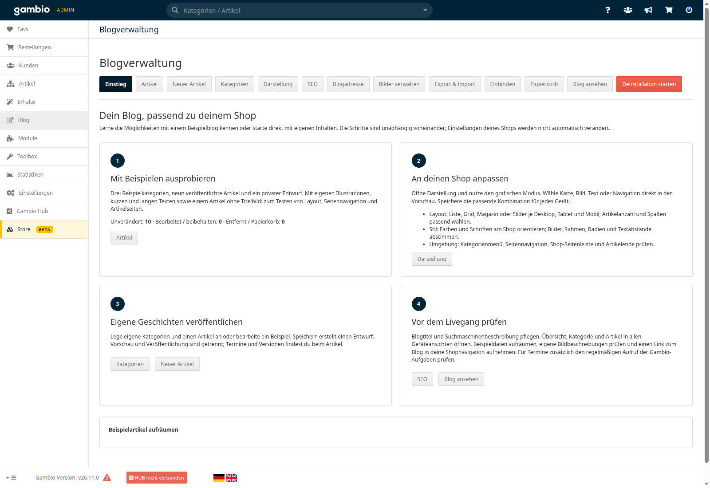
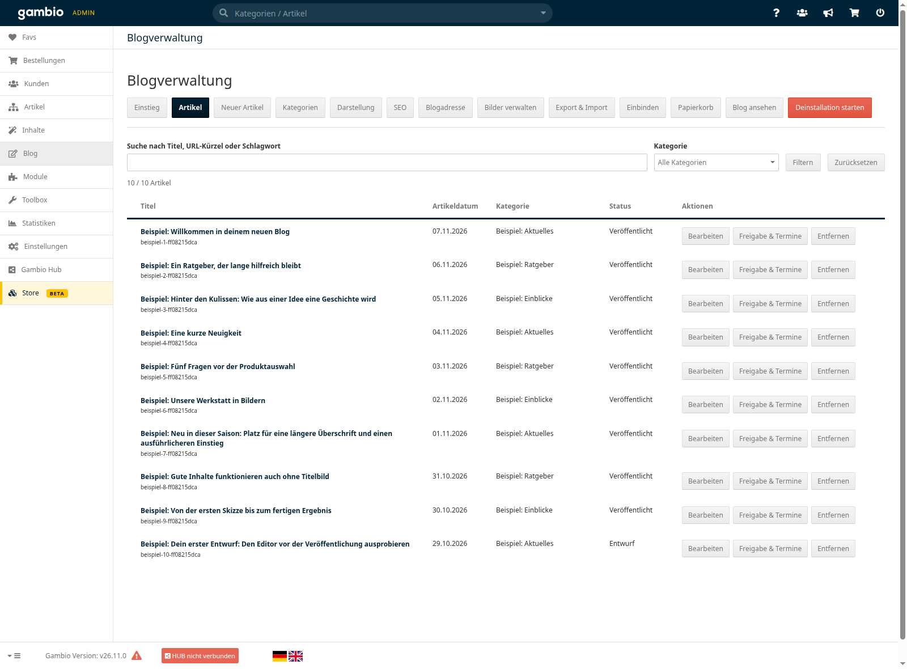
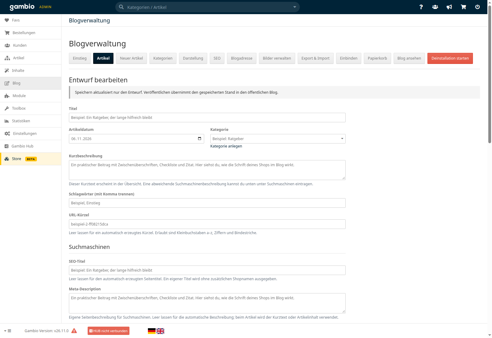
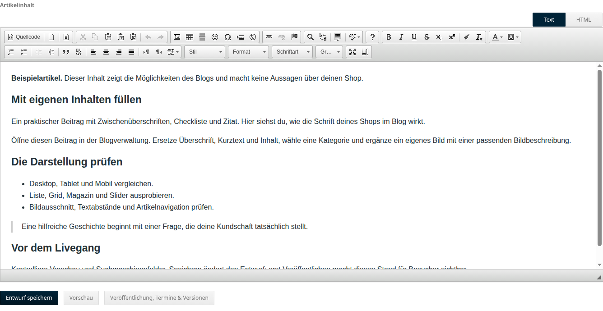
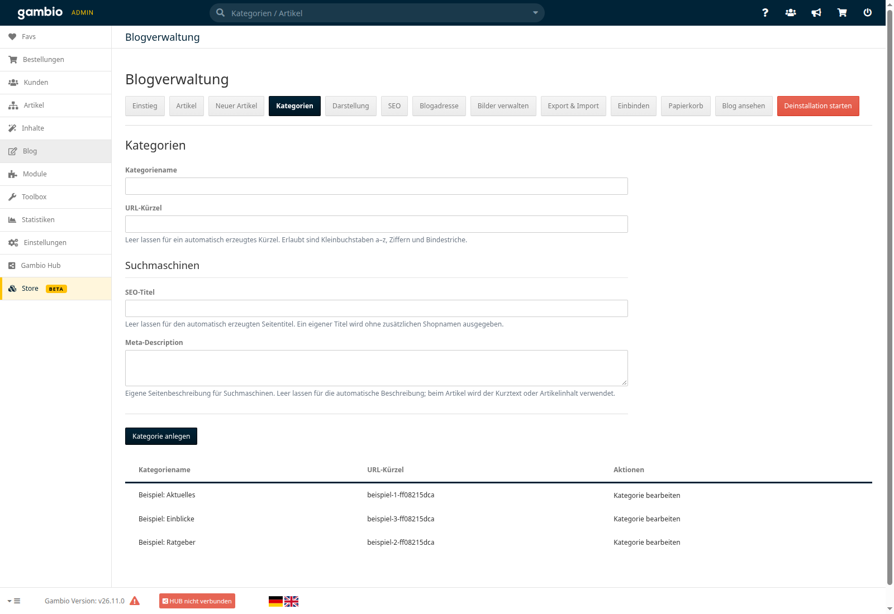
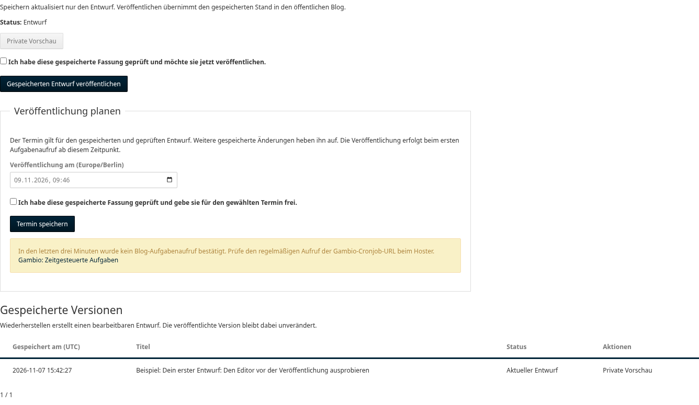
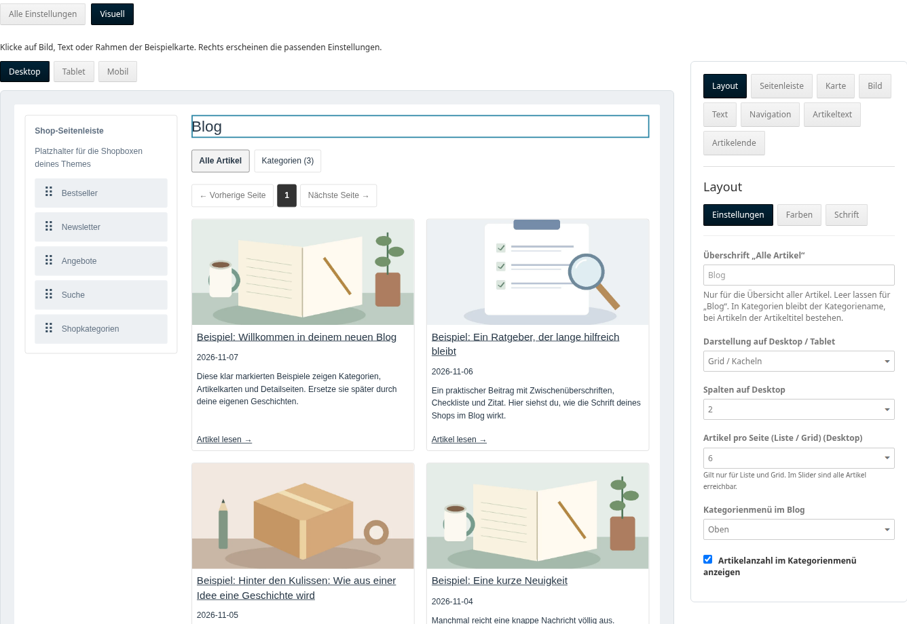
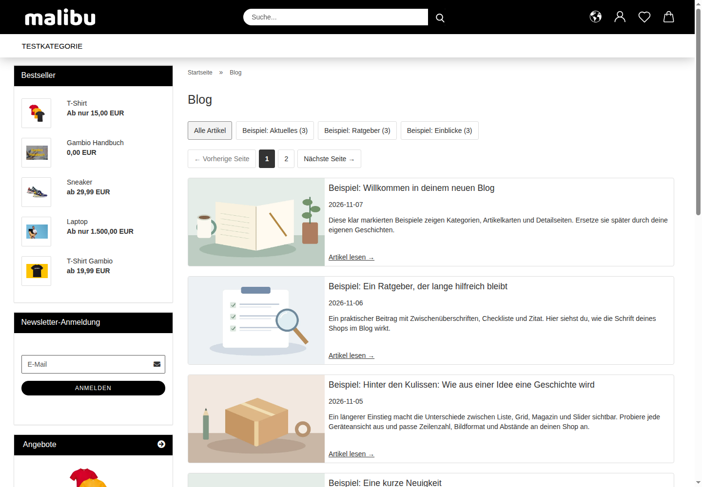
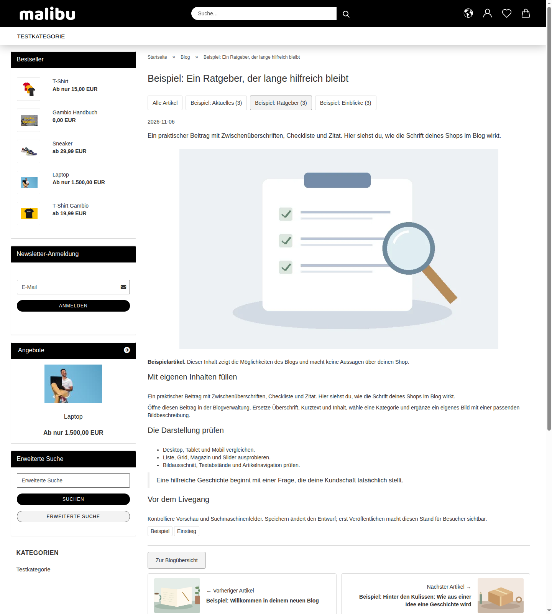
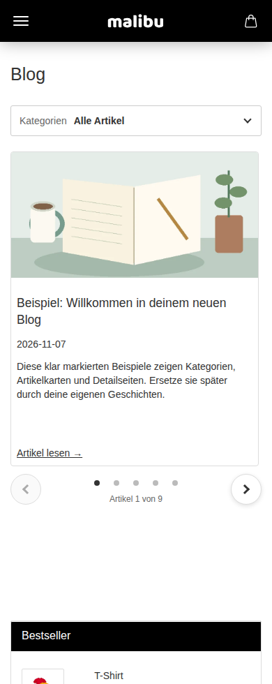

# c1zz Blog in Bildern

Zehn echte Ansichten zeigen den Weg vom Einstieg über das Schreiben und Gestalten bis zum öffentlichen Blog. Klicke auf ein Bild, um die Bedienelemente in Originalgröße zu lesen.

**Aufgenommen am 09.11.2026:** Modul 0.40.2 im lokalen Gambio 26.11.0 mit Malibu und optionalen Beispielinhalten. Die Detailaufnahmen von Schreibeditor, Freigabe und Darstellung zeigen gezielte Ausschnitte. Das Erscheinungsbild hängt vom Shoptheme und den Einstellungen ab. Die Bilder ergänzen den [dokumentierten Teststand](KOMPATIBILITAET.md).

[Zur Projektübersicht](../README.md) · [Zur Installation](INSTALLATION.md)

| Ansicht | Das siehst du |
|---|---|
| [1. Einstieg](#ansicht-1) | Geführter Einstieg mit vier Schritten und Verwaltung der Beispielartikel |
| [2. Artikelverwaltung](#ansicht-2) | Artikelübersicht mit Suche, Kategorien, Veröffentlichungsstatus und Aktionen |
| [3. Artikeldaten und SEO](#ansicht-3) | Artikelformular mit Titel, Kategorie, Kurzbeschreibung und Suchmaschinenfeldern |
| [4. Inhalte schreiben](#ansicht-4) | Nativer Schreibeditor mit Beispieltext, Formatierungsleiste und Entwurfsaktionen |
| [5. Kategorien verwalten](#ansicht-5) | Kategorieformular mit SEO-Feldern und Liste bestehender Kategorien |
| [6. Freigabe, Termine und Versionen](#ansicht-6) | Freigabe eines privaten Entwurfs, Terminplanung, Aufgabenhinweis und gespeicherte Version |
| [7. Darstellung mit Vorschau](#ansicht-7) | Grafischer Editor mit Grid-Vorschau und Layoutoptionen für Desktop |
| [8. Öffentlicher Blog auf Desktop](#ansicht-8) | Öffentliche Blogliste im vollständigen Malibu-Shoplayout |
| [9. Öffentliche Artikelseite](#ansicht-9) | Öffentlicher Ratgeber mit Titelbild, gegliedertem Text und Shopumgebung |
| [10. Öffentlicher Blog auf Mobilgeräten](#ansicht-10) | Mobile Blogansicht mit Kategorieauswahl und Artikelslider |

## 1. Einstieg

Nach der Installation führt **Einstieg** durch Beispielblog, Gestaltung, eigene Inhalte und Livegang. In diesem Testshop wurden die optionalen Beispiele bereits angelegt. Eine Neuinstallation startet leer.

## 2. Artikelverwaltung

Die Übersicht verbindet Suche, Kategoriefilter und Status mit den Aktionen **Bearbeiten** und **Freigabe & Termine**. Zu sehen sind neun veröffentlichte Beispiele und ein privater Entwurf.

## 3. Artikeldaten und SEO

Im oberen Teil des Artikelformulars pflegst du Titel, Datum, Kategorie, Kurzbeschreibung, Schlagwörter und URL-Kürzel. SEO-Titel und Meta-Description stehen im selben Formular. Speichern aktualisiert den Entwurf; die Veröffentlichung ist ein eigener Schritt.

## 4. Inhalte schreiben

Dieser Ausschnitt zeigt den Inhaltsbereich weiter unten im selben Formular: nativer Gambio-Editor mit Formatierung und HTML-Ansicht sowie die Aktionen für Entwurf, Vorschau und Veröffentlichung. Der Beispieltext enthält Zwischenüberschriften, eine Liste und ein Zitat.

## 5. Kategorien verwalten

Eigene Kategorien lassen sich unabhängig von Artikeln anlegen. Name, URL-Kürzel und Suchmaschinenangaben gehören zur Kategorie. Unter dem Formular stehen die bereits vorhandenen Beispielkategorien.

## 6. Freigabe, Termine und Versionen

Der Ausschnitt zeigt die Freigabe eines gespeicherten Entwurfs, die Terminplanung und die vorhandene Version. Beide Freigaben verlangen eine ausdrückliche Bestätigung. Der gelbe Hinweis ist im lokalen Testshop sichtbar, weil kein regelmäßiger Aufgabenaufruf bestätigt ist; geplante Veröffentlichungen benötigen diesen Aufruf. Für die Aufnahme wurde nichts veröffentlicht oder eingeplant.

## 7. Darstellung mit Vorschau

Im grafischen Editor wählst du Geräteansicht und Bereich, zum Beispiel Layout, Karte, Bild oder Text. Hier zeigt der Ausschnitt eine **ungespeicherte Grid-Vorschau** mit zwei Spalten und den passenden Layoutoptionen. Die gespeicherten Einstellungen wurden für die Aufnahme nicht verändert.

## 8. Öffentlicher Blog auf Desktop

Die gespeicherte Desktopansicht verwendet eine Liste. Shopkopf und Seitenleiste zeigen die Einbindung in Malibu; innerhalb des Blogs führen Kategorien und Seitennavigation durch die Artikel. Die Aufnahme erfolgt als Gast.

## 9. Öffentliche Artikelseite

Der Ratgeber zeigt Titel, Kategorie, Datum, Kurzbeschreibung und Titelbild sowie den formatierten Artikeltext. Shopkopf und Seitenleiste bleiben Bestandteil der Shopdarstellung.

## 10. Öffentlicher Blog auf Mobilgeräten

Bei 390 Pixeln Breite verwendet dieser Beispielshop einen Slider mit Pfeilen, Punkten und Artikelzähler. Die Kategorien sind über eine kompakte Auswahl erreichbar. Desktop und Mobil können unterschiedliche Darstellungen verwenden.

[Zur Projektübersicht](../README.md) · [Installation](INSTALLATION.md)
